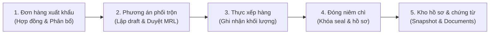
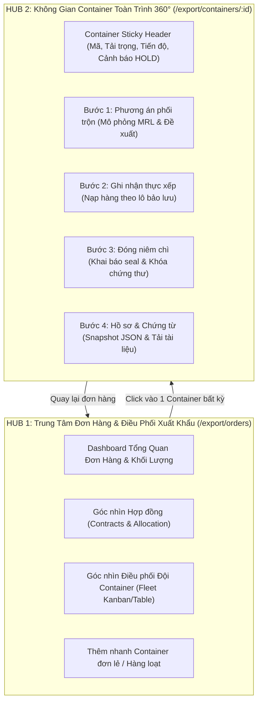

# Kế Hoạch Tinh Gọn & Tái Cấu Trúc Các Màn Hình Xuất Khẩu
## (Export Orders, Blend Plans, Containers & Dossiers Redesign Plan)

---

## 1. Tóm Tắt & Bối Cảnh Nghiệp Vụ

Trong hệ thống **GrainLedger** (chuỗi cung ứng xuất khẩu lúa gạo tuân thủ cân bằng khối lượng ISO 22095), quy trình xuất khẩu vận hành theo mô hình phân cấp tự nhiên:

$$\text{Hợp đồng / Đơn hàng (Order)} \longrightarrow \text{Các Container (Containers)} \longrightarrow \text{Vòng đời 4 bước của Container}$$

Mỗi container khi đưa vào thực hiện phải trải qua **4 giai đoạn tuần tự**:
1. **Lập phương án phối trộn (Blend Planning)**: Chọn sản phẩm đích, kho/cơ sở chế biến, tính toán mô phỏng lô thóc/gạo, đánh giá an toàn MRL, trình phê duyệt bảo lưu tồn kho.
2. **Thực xếp hàng (Actual Loading)**: Ghi nhận khối lượng thực tế nạp vào container từ các lô đã bảo lưu và kiểm tra điều kiện sẵn sàng.
3. **Đóng niêm chì (Closure)**: Cập nhật số container, số kẹp chì niêm phong, kiểm tra đủ tải trọng và khóa chứng thư xuất xưởng.
4. **Hồ sơ & Chứng từ (Dossier & Documents)**: Tra cứu snapshot JSON đã niêm phong, đính kèm và tải về các chứng từ xuất khẩu (B/L, Packing List, Phyto, COA...).



---

## 2. Phân Tích Hiện Trạng & Các Điểm Nghẽn UX (Pain Points)

Hiện tại, chức năng xuất khẩu đang bị phân tách thành **4 màn hình/view cấp cao riêng rẽ** trên thanh điều hướng (`ExportWorkspacePage` với 4 tabs: `orders`, `plans`, `containers`, `dossiers`), kết hợp với các trang con độc lập (`BlendPlanRequestPage`, `ContainerWorkflowPage` 3 steps):

```
[Hiện tại - 4 Views riêng rẽ & nhiều tầng điều hướng]
├── /export/orders              (Đơn hàng xuất khẩu - Table + Modal Order Detail)
├── /export/plans               (Phương án phối trộn - Chọn Order + Container -> Card list)
├── /export/containers          (Container xuất khẩu - Kanban board: Planned/Loading/Closed)
├── /export/dossiers            (Hồ sơ container - Master-detail container Closed)
├── /export/orders/:id/.../plan (Trang độc lập BlendPlanRequestPage)
└── /export/containers/:id/...  (Trang ContainerWorkflowPage: loading / closure / dossier)
```

### Điểm nghẽn 1: Phân mảnh tư duy nghiệp vụ (Context Switching)
- Khi nhân viên xuất khẩu (`CUSTOMER_EXPORT_OFFICER`) làm việc, họ làm theo từng **Đơn hàng** hoặc từng **Container**.
- Nhưng với thiết kế hiện tại:
  - Muốn lập phương án: Vào tab **Yêu cầu phương án** -> phải chọn lại Đơn hàng trong dropdown -> chọn Container trong dropdown thứ 2 -> bấm "Tạo phương án".
  - Muốn ghi nhận thực xếp: Chuyển sang tab **Xếp container** -> lại phải chọn lại Đơn hàng -> tìm thẻ container trong Kanban -> bấm "Xếp hàng" -> điều hướng sang `ContainerWorkflowPage`.
  - Muốn tải hồ sơ: Lại chuyển sang tab **Hồ sơ & Chứng từ** -> lại chọn lại Đơn hàng -> tìm container đã đóng niêm.
- **Hậu quả**: Người dùng phải liên tục chọn lại dropdown đơn hàng, mất ngữ cảnh đang làm việc, cảm thấy các màn hình bị rời rạc.

### Điểm nghẽn 2: Màn hình "Phương án phối trộn" (`/export/plans`) và "Hồ sơ container" (`/export/dossiers`) bị dư thừa
- **Màn hình Plans**: Bản chất chỉ là bộ lọc Đơn hàng + Container để liệt kê danh sách version của phương án phối trộn. Đây là thông tin thuộc về **chi tiết của container**, không cần thiết phải tách thành 1 trang riêng độc lập ở menu chính.
- **Màn hình Dossiers**: Bản chất chỉ là danh sách các container có trạng thái `CLOSED`. Khi mở một container `CLOSED`, nội dung hiển thị (Snapshot, chứng từ) lại trùng lặp 90% với tab `dossier` của `ContainerWorkflowPage`.

### Điểm nghẽn 3: Thao tác nhập liệu container còn thủ công và chậm
- Để tạo các container cho một hợp đồng 250 tấn (tương đương 10 containers 25 tấn), người dùng hiện phải nhập từng container một trong form "Thêm container" (gõ 25000 -> bấm Thêm -> đợi ETag refetch -> gõ tiếp 25000 -> bấm Thêm... lặp lại 10 lần).
- Chưa có tính năng **Tạo nhanh hàng loạt container (Bulk Container Allocation)** theo quy cách chuẩn (ví dụ: chia đều số tấn còn lại thành $N$ container 20ft / 40ft).

### Điểm nghẽn 4: Trải nghiệm trong trang Container Workflow bị chia cắt
- `ContainerWorkflowPage` hiện chia thành 3 sub-routes rời rạc (`/loading`, `/closure`, `/dossier`), và đẩy bước "Phối trộn" sang một trang URL hoàn toàn khác (`/plan`).
- Khi người dùng nạp hàng xong (đủ 100%), họ phải chủ động tìm link bấm sang tab "Niêm phong", rồi lại tìm link bấm sang "Hồ sơ". Thiếu cảm giác của một **Quy trình liền mạch có hướng dẫn (Guided Stepper)**.

---

## 3. Kiến Trúc Đề Xuất: Hợp Nhất Thành 2 Trung Tâm Thao Tác Liền Mạch

Thay vì duy trì 4 màn hình rời rạc gây bối rối, đề xuất tái cấu trúc thành **2 trung tâm làm việc chính (2 Core Hubs)**:



### 3.1. Hub 1: Trung Tâm Đơn Hàng & Điều Phối Xuất Khẩu (`/export/orders`)
**Mục tiêu**: Quản lý toàn bộ vòng đời hợp đồng xuất khẩu và tình trạng phân bổ container từ góc nhìn tổng quan (Bird's Eye View).

- **Thanh chuyển đổi chế độ xem (View Mode Switcher)** tiện lợi ngay trên đầu trang:
  1. **Chế độ Hợp đồng (Contract View - Mặc định)**:
     - Danh sách đơn hàng với đầy đủ KPI: Mã hợp đồng, Khách hàng, Cửa sổ giao hàng (Shipping Window), Tiến độ phân bổ khối lượng vào container.
     - Khi chọn một Đơn hàng: Mở ngay **Bảng điều khiển chi tiết Đơn hàng (Order Command Panel)** ở bên cạnh hoặc drawer/inline:
       - Xem quy cách chất lượng & MRL limits.
       - Thanh tiến độ nạp tổng thể của toàn đơn hàng ($X$ kg / $Y$ kg đã xếp).
       - Bảng danh sách các container thuộc đơn hàng kèm trạng thái từng bước (Badge mini: Phối trộn -> Xếp hàng -> Niêm phong -> Hồ sơ).
       - Nút hành động: **"Thêm container"** (hỗ trợ nhập 1 container hoặc sinh hàng loạt container tự động).
  2. **Chế độ Điều phối Container (Container Fleet View)**:
     - Hiển thị bảng Kanban 3 cột hoặc Table danh sách toàn bộ container của đơn hàng được chọn (hoặc tất cả đơn hàng):
       - *Cột 1: Chuẩn bị & Phối trộn (PLANNED)*
       - *Cột 2: Đang xếp hàng (LOADING)*
       - *Cột 3: Đã đóng niêm & Có hồ sơ (CLOSED)*
     - Cho phép lọc nhanh theo trạng thái, tìm kiếm theo số container / seal / mã nội bộ.

### 3.2. Hub 2: Không Gian Container Toàn Trình 360° (`/export/containers/:id`)
**Mục tiêu**: Xử lý toàn diện mọi công việc của một container cụ thể trong duy nhất một màn hình, không bị chuyển trang gây đứt đoạn.

- **Header thông tin cố định (Container HUD/Header)**:
  - Mã nội bộ container (`c.internalCode`), Số hiệu container thực tế, Số seal chì.
  - Mã đơn hàng liên kết (có link quay lại đơn hàng ngay lập tức).
  - StatusBadge nổi bật (`PLANNED`, `LOADING`, `CLOSED`, hoặc `HOLD`).
  - Thanh tiến độ nạp: Khối lượng mục tiêu, Khối lượng đã xếp, Khối lượng còn lại, % hoàn thành.
  - Banner cảnh báo phong tỏa kiểm dịch nếu container đang dính lệnh **HOLD**.

- **Thanh tiến trình 4 giai đoạn (Interactive 4-Step Stepper)**:
  - **Tự động kích hoạt thông minh (Smart Auto-Step)**:
    - Nếu container mới tạo chưa có phương án duyệt -> Tự động focus vào **Bước 1: Phương án phối trộn**.
    - Nếu container đã duyệt phương án và đang xếp -> Tự động focus vào **Bước 2: Thực xếp hàng**.
    - Nếu container đã nạp đủ 100% -> Tự động gợi ý chuyển sang **Bước 3: Đóng niêm chì**.
    - Nếu container đã CLOSED -> Tự động mở **Bước 4: Hồ sơ & Chứng từ**.
  - Người dùng có thể tự do bấm chuyển qua lại giữa các bước để tra cứu thông tin (ví dụ: đang ở bước xếp hàng vẫn có thể bấm lại bước 1 để xem lại phương án phối trộn và thành phần lô).

---

## 4. Chi Tiết Tối Ưu Hóa Nhập Liệu & Tương Tác Nghiệp Vụ

### 4.1. Cải tiến Form Phân bổ Container: Thêm tính năng "Sinh hàng loạt" (Bulk Generation)
Trong hộp thoại hoặc form thêm container:
- **Tùy chọn 1: Thêm thủ công 1 container**: Nhập số kg mục tiêu.
- **Tùy chọn 2: Phân bổ hàng loạt (Bulk Split)**:
  - Người dùng chỉ cần chọn kích thước container tiêu chuẩn (ví dụ: *Container 20ft: ~25.000 kg* hoặc *Container 40ft: ~28.000 kg*).
  - Hệ thống tự động tính số lượng container cần tạo dựa trên số kg còn lại của đơn hàng (`remainingMassKg`).
  - Ví dụ: Đơn còn 100.000 kg -> Hệ thống đề xuất tạo 4 container $\times$ 25.000 kg chỉ với 1 click.

### 4.2. Tích hợp màn hình Phương án phối trộn trực tiếp vào Bước 1 của Container 360°
- Thay vì bắt người dùng mở trang riêng `/export/orders/:id/containers/:id/plan`, toàn bộ giao diện:
  - Chọn sản phẩm đích & cơ sở xay xát.
  - Xem kho nguyên liệu khả dụng & chạy mô phỏng phối trộn.
  - Đánh giá biên an toàn MRL (Pass/Fail/Margin).
  - Gửi đề xuất phê duyệt lên Quản lý.
- Sẽ được nhúng trực quan thành nội dung của **Tab 1: Phương án phối trộn** trong màn hình Container 360°.

### 4.3. Tối ưu hóa Bước 2: Thực xếp hàng (Loading Form)
- **Nút "Xếp đủ theo lô" (Quick-fill balance)**: Thay vì bắt người dùng gõ từng con số lẻ, cung cấp nút bấm nhanh "Điền tối đa" cho từng lô nguyên liệu đã bảo lưu.
- **Tính toán tải trọng tự động theo thời gian thực (Real-time Balance Calculator)**:
  - Hiển thị ngay số kg còn thiếu để đạt 100% mục tiêu container.
  - Ngăn chặn nhập vượt quá tải trọng mục tiêu hoặc vượt quá lượng lô bảo lưu trước khi gửi request lên máy chủ.

### 4.4. Tối ưu hóa Bước 3: Đóng niêm chì (Closure Form)
- Kiểm tra điều kiện đóng niêm theo thời gian thực (Checklist trực quan):
  - [x] Đã nạp đủ khối lượng mục tiêu ($100\%$).
  - [x] Đã nhập Số container (Container No) hợp lệ theo chuẩn ISO 6346.
  - [x] Đã nhập Số niêm chì (Seal No).
  - [x] Không có cảnh báo phong tỏa kiểm dịch (No Active HOLD).
- Khi tất cả điều kiện xanh, nút **"Xác nhận đóng niêm & Phát hành hồ sơ"** sẽ sáng lên với hiệu ứng rõ ràng.

### 4.5. Tối ưu hóa Bước 4: Hồ sơ & Chứng từ (Dossier & Document Hub)
- Tích hợp cả 2 tác vụ quan trọng vào cùng 1 nơi:
  1. **Snapshot JSON niêm phong**: Tải snapshot gốc có chữ ký hệ thống để phục vụ đối soát hải quan và truy vết chuỗi.
  2. **Tủ chứng từ điện tử (Document Vault)**:
     - Kéo thả upload chứng từ (Vận đơn B/L, Phiếu đóng gói, Kiểm dịch, COA...).
     - Lọc theo loại chứng từ, xem lịch sử phiên bản (`v1`, `v2`...), tải về từng chứng từ với 1 click.

---

## 5. Chiến Lược Xử Lý Điều Hướng & Tính Tương Thích (Backwards Compatibility)

Để đảm bảo không làm gãy các liên kết hiện hữu, bookmarks, thanh sidebar và **giữ nguyên 100% pass cho bộ test tự động**:

| Đường Dẫn (Route) | Trạng Thái Mới | Hành Vi / Giao Diện Mới |
| :--- | :--- | :--- |
| `/export/orders` | **Giữ nguyên (Chính)** | **Hub 1: Trung tâm Đơn hàng & Điều phối xuất khẩu**. Tích hợp bảng danh sách đơn hàng + Drawer/Master-detail quản lý container của đơn hàng. |
| `/export/containers` | **Giữ nguyên** | Mở Hub 1 ở chế độ **Góc nhìn Container (Fleet View)**, hiển thị toàn bộ container đang thực hiện. |
| `/export/plans` | **Redirect / Alias thông minh** | Chuyển hướng tới `/export/orders` với bộ lọc container ở trạng thái `PLANNED` (hoặc mở trực tiếp trang review nếu có `planId`). |
| `/export/dossiers` | **Redirect / Alias thông minh** | Chuyển hướng tới `/export/orders` với bộ lọc container ở trạng thái `CLOSED` (Kho hồ sơ). |
| `/export/containers/:id` | **Mới (Trọng tâm)** | **Hub 2: Container 360° All-in-One Workspace**. Tự động mở tab tương ứng theo trạng thái container. |
| `/export/containers/:id/loading` | **Giữ nguyên tương thích** | Mở Container 360° với tab mặc định là `loading`. |
| `/export/containers/:id/closure` | **Giữ nguyên tương thích** | Mở Container 360° với tab mặc định là `closure`. |
| `/export/containers/:id/dossier` | **Giữ nguyên tương thích** | Mở Container 360° với tab mặc định là `dossier`. |
| `/export/orders/:orderId/containers/:containerId/plan` | **Giữ nguyên tương thích** | Mở Container 360° với tab mặc định là `plan` (hoặc modal nếu được gọi từ nút hành động). |

> [!NOTE]
> **Thanh điều hướng Sidebar cho `CUSTOMER_EXPORT_OFFICER`**:
> Thay vì hiển thị 4 mục rườm rà ("Đơn xuất khẩu", "Yêu cầu phương án", "Xếp container", "Hồ sơ & Chứng từ"), ta có thể tinh gọn thành **2 mục rõ ràng**:
> 1. **"Đơn hàng & Điều phối"** (`/export/orders`) - Biểu tượng `Export`
> 2. **"Kho hồ sơ xuất khẩu"** (`/export/dossiers` hoặc tab Closed của Hub) - Biểu tượng `FileText`
> Giúp sidebar gọn gàng, người dùng tập trung vào quy trình chính.

---

## 6. Lộ Trình Triển Khai Cụ Thể (Phased Implementation Plan)

### Giai đoạn 1: Xây dựng Container 360° All-in-One Workspace
- Hợp nhất `BlendPlanRequestPage` và 3 sub-pages của `ContainerWorkflowPage` (`loading`, `closure`, `dossier`) thành một component thống nhất `Container360Workspace`.
- Xây dựng thanh Stepper 4 bước với Header cố định và tính năng Smart Auto-Step.
- Tái sử dụng các sub-component hoàn thiện đã có: `ContainerLoadingForm`, `ContainerClosureForm`, `ContainerDossierPanel`, `ContainerReadiness`, `ContainerProductionPanel`.

### Giai đoạn 2: Tái cấu trúc Hub Đơn hàng & Điều phối (`ExportWorkspacePage`)
- Tích hợp 2 chế độ hiển thị: Contract View (theo hợp đồng) và Fleet Kanban View (theo container).
- Xây dựng bảng điều khiển chi tiết Đơn hàng inline (Order Detail Drawer) để người dùng xem chỉ tiêu chất lượng và danh sách container của đơn hàng mà không cần chuyển trang.
- Bổ sung nút bấm trực tiếp vào Container 360° từ danh sách container.

### Giai đoạn 3: Bổ sung tiện ích nhập liệu năng suất cao (Productivity Tools)
- Thêm tính năng **Tạo container hàng loạt (Bulk Container Allocation)** trong form phân bổ.
- Thêm nút **Điền nhanh khối lượng (Quick-fill Balance)** trong form thực xếp hàng.

### Giai đoạn 4: Cập nhật Routes, Sidebar & Xác thực Kiểm thử
- Cập nhật `paths.ts`, `routes.tsx`, và `sidebarItems.ts`.
- Chạy kiểm thử tự động toàn diện:
  - `npm test` (đảm bảo cả 172+ test cases pass 100%).
  - `npm run lint -- --max-warnings 0`.
  - `npm run build` (kiểm tra TypeScript và Vite bundle build).

---

## 7. Các Quyết Định Thiết Kế Cần Người Dùng Xác Nhận (Decisions for Review)

1. **Về cấu trúc Sidebar**: Bạn có muốn gộp 4 mục xuất khẩu trên sidebar thành **2 mục tinh gọn** (`Đơn hàng & Xuất khẩu` và `Kho hồ sơ & Chứng từ`), hay muốn giữ nguyên 4 mục trên sidebar để chuyển nhanh giữa các góc nhìn?
2. **Về chế độ xem mặc định tại Hub 1**: Bạn muốn khi vào menu xuất khẩu, hệ thống mặc định mở **Góc nhìn theo Đơn hàng (Hợp đồng)** hay **Góc nhìn Kanban Container (Điều phối)**?
3. **Về tính năng tạo Container hàng loạt**: Bạn có muốn cấu hình trước kích thước container mặc định (ví dụ mặc định là 25.000 kg cho lúa gạo xuất khẩu) để hệ thống tự động điền khi bấm phân bổ không?
